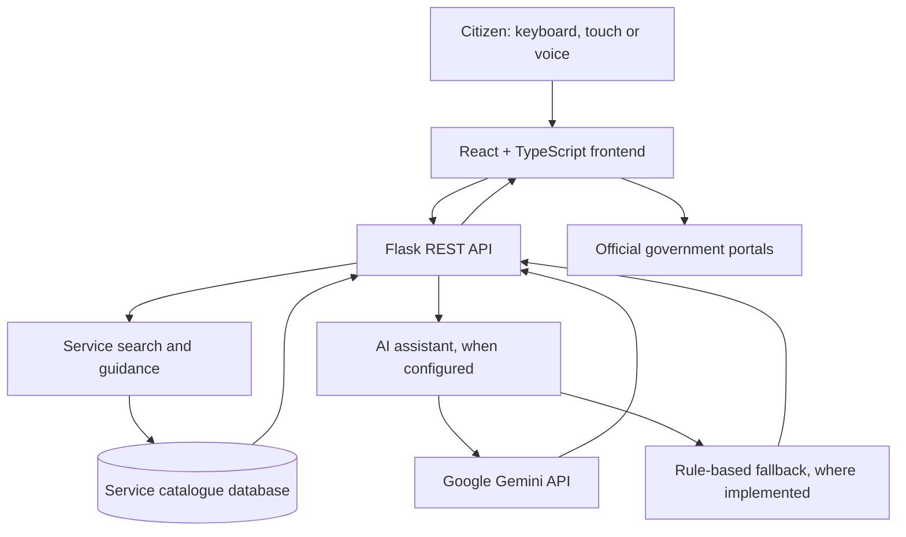

# MeeSeva Mitra AI (మీసేవ మిత్ర)

**AI-powered citizen-service navigator for Telangana government services**

MeeSeva Mitra AI is a citizen-assistance prototype designed to help people discover and understand selected Telangana government services. It supports service search in English, Telugu, and Romanized Telugu (Telugish), and provides service information, document checklists, step-by-step guidance, voice input in supported browsers, and links to relevant official portals.

> **Disclaimer:** MeeSeva Mitra AI is an independent prototype developed for the AIKAM ESD Innovation Challenge – Telangana. It is not an official Government of Telangana, MeeSeva, or ESD application. It does not submit government applications, collect statutory payments, or access private application records. Always confirm current requirements with the relevant official department or an authorised MeeSeva centre.

## Highlights

- **Multilingual service discovery:** Search using English, Telugu script, and Romanized Telugu.
- **English and Telugu interface:** Switch the interface language.
- **Voice input:** Speech-to-text in supported browsers using Telugu (`te-IN`) or Indian English (`en-IN`).
- **Service guidance:** View service descriptions, application steps, and document requirements for the services in the catalogue.
- **Document checklist:** Mark documents as ready and use the checklist to prepare for an official application.
- **AI assistant:** Ask questions about listed services. Responses may use service information retrieved from the local catalogue.
- **Rejection guidance:** Get general explanations and suggested next steps for selected common application issues.
- **Official portal links:** Continue the process through the relevant government portal.
- **Feedback:** Submit feedback about the guidance experience.
- **Resilient guidance:** Where implemented, cached information and rule-based responses can help when the AI provider is unavailable. Live AI features still require network access.

Feature availability depends on the current implementation and configuration. Government rules, fees, documents, processing times, and links can change; verify them with official sources before acting.

## Problem

Citizens may struggle to identify the correct service, understand administrative terminology, determine which documents apply to their circumstances, or navigate different departmental portals. Language and connectivity barriers can make these tasks harder.

## Approach

MeeSeva Mitra AI provides a guidance layer in front of existing government services. It helps users discover relevant information and prepare for the official process while keeping formal submissions and decisions within authorised government channels.

## Technology stack

| Layer | Technology |
|---|---|
| Frontend | React, TypeScript, Vite |
| Styling | Tailwind CSS |
| Backend | Python, Flask REST API |
| Database | SQLite for local development; MySQL support is described in the project configuration |
| AI integration | Google Gemini API, when configured |
| Voice input | Browser Web Speech API, where supported |

Check `frontend/package.json` and `backend/requirements.txt` for the exact dependencies and versions used by the current checkout.

## Architecture



The application provides guidance and links; it does not directly submit applications to government systems.

## Repository structure

The following is the intended layout described by the project documentation. Confirm it against the files in your current repository.

```text
meeseva-mitra-ai/
├── backend/
│   ├── app.py
│   ├── db.py
│   ├── services.py
│   ├── ai_assistant.py
│   ├── init_sqlite.py
│   ├── requirements.txt
│   └── .env.example
├── frontend/
│   ├── package.json
│   ├── vite.config.ts
│   └── src/
├── database/
│   ├── schema.sql
│   └── seed_data.sql
├── docs/
│   ├── API.md
│   └── ARCHITECTURE.md
├── tests/
│   ├── test_api.py
│   └── test_telugish.py
├── .env.example
├── .gitignore
└── README.md
```

Do not commit real `.env` files, API keys, passwords, private user data, virtual environments, `node_modules`, or build output.

## Prerequisites

- Python compatible with the dependencies in `backend/requirements.txt` (Python 3.12 is the documented target).
- Node.js and npm compatible with `frontend/package.json`.
- A modern browser. Voice recognition support varies by browser.
- A Gemini API key only if you want to enable the live Gemini integration.
- MySQL only if you choose to configure the application to use MySQL; SQLite is intended for local development.

Check installed versions:

```bash
python --version
node --version
npm --version
```

## Installation and local setup

Commands below follow the project layout described in the documentation. If your checkout differs, adjust paths to match the actual files.

### 1. Clone the repository

Replace the URL with your actual GitHub repository URL.

```bash
git clone https://github.com/YOUR-USERNAME/meeseva-mitra-ai.git
cd meeseva-mitra-ai
```

### 2. Configure environment variables

Copy the relevant example file and edit it locally. Use only variables that are actually read by the current code.

**Windows PowerShell:**

```powershell
Copy-Item backend\.env.example backend\.env
```

**Linux/macOS:**

```bash
cp backend/.env.example backend/.env
```

If the project loads a root-level `.env` instead, copy the root `.env.example` to `.env` as well. Never commit the real `.env` file.

To enable Gemini, configure your own key in the location read by the backend:

```dotenv
GEMINI_API_KEY=replace_with_your_own_key
GEMINI_MODEL=gemini-3.1-flash-lite
```

The model identifier must match a model available to your Google AI account and supported by the installed SDK. Do not publish your key. If the key is absent or the provider is unavailable, fallback behaviour depends on the current backend implementation.

### 3. Install and start the backend

**Windows PowerShell:**

```powershell
cd backend
python -m venv .venv
.\.venv\Scripts\Activate.ps1
python -m pip install -r requirements.txt
python init_sqlite.py
python app.py
```

**Linux/macOS:**

```bash
cd backend
python3 -m venv .venv
source .venv/bin/activate
python -m pip install -r requirements.txt
python init_sqlite.py
python app.py
```

The backend is documented to run on `http://127.0.0.1:5000`. Confirm the actual host and port in the startup output and configuration.

### 4. Install and start the frontend

Open a second terminal from the repository root:

```bash
cd frontend
npm install
npm run dev
```

Open the local URL printed by Vite (typically `http://localhost:5173`).

### 5. Verify the backend

If the health endpoint is implemented, test it with:

```bash
curl http://127.0.0.1:5000/api/health
```

A successful response should indicate that the API is running. Database status and response fields depend on the current implementation.

## Configuration

The following variables are described by the project documentation. Confirm the exact names, defaults, and loading location in the backend before relying on them.

| Variable | Purpose |
|---|---|
| `GEMINI_API_KEY` | Optional key for Gemini-powered responses |
| `GEMINI_MODEL` | Gemini model identifier |
| `PORT` | Backend listening port, if configurable |
| `DB_HOST` | MySQL host, if MySQL is enabled |
| `DB_PORT` | MySQL port, if MySQL is enabled |
| `DB_NAME` | MySQL database name, if MySQL is enabled |
| `DB_USER` | MySQL username, if MySQL is enabled |
| `DB_PASSWORD` | MySQL password, if MySQL is enabled |
| `CORS_ORIGINS` | Allowed frontend origins, if configurable |
| `AI_RATE_LIMIT` | AI request rate limit, if configurable |
| `SECRET_KEY` | Application secret, if used |

Do not use development defaults or a development server as a production deployment configuration.

## Database

The project documentation describes a service catalogue with records for departments, services, requirements, source references, feedback, and chat-session metadata. The exact tables and columns are defined by the current schema and database initialization scripts.

For local SQLite setup, the documented command is:

```bash
cd backend
python init_sqlite.py
```

**Warning:** Check `backend/init_sqlite.py` before running it against an existing database. An initializer may drop and recreate tables, which can delete local data. Back up any data you need first.

For MySQL, review `database/schema.sql`, `database/seed_data.sql`, and the actual connection configuration. Do not assume MySQL is active unless the backend is configured and tested against it.

## API overview

The project documentation describes the following endpoints. Confirm their availability and request/response schemas in the current backend and in `docs/API.md`.

| Method | Endpoint | Purpose |
|---|---|---|
| `GET` | `/` | API information |
| `GET` | `/api/health` | Health and database connectivity check |
| `GET` | `/api/services` | List available services |
| `GET` | `/api/services/search?q=<query>&lang=<en\|te>` | Search services |
| `GET` | `/api/services/<slug>` | Retrieve service details |
| `POST` | `/api/assistant` | Submit a question to the assistant |
| `POST` | `/api/guidance/rejection` | Request general rejection guidance |
| `POST` | `/api/feedback` | Submit user feedback |

For full request bodies, response examples, validation rules, and error codes, see [`docs/API.md`](docs/API.md), if present.

Example health check:

```bash
curl http://127.0.0.1:5000/api/health
```

Example service search:

```bash
curl "http://127.0.0.1:5000/api/services/search?q=income&lang=en"
```

## AI behaviour and limitations

When configured, the backend can send a user question and relevant service-catalogue context to the configured AI provider. The intended design is to ground guidance in stored service information and use a rule-based fallback where implemented.

AI-generated explanations can still be incomplete or incorrect. Fallback responses are only as reliable as the underlying catalogue. Neither approach guarantees that government rules are current or that every answer is correct. Avoid entering Aadhaar numbers, OTPs, passwords, financial details, or other sensitive personal information.

## Language and accessibility

The project is designed to support English, Telugu, and Romanized Telugu search, plus browser-dependent speech recognition. Voice input may not work in every browser or device and can require microphone permission or an internet connection depending on browser implementation.

The project aims to provide a responsive, accessible interface. Formal GIGW 3.0 or WCAG compliance should not be claimed unless a documented accessibility audit has verified it.

## Testing

The project documentation lists these test commands:

```bash
python -m unittest tests/test_api.py
python tests/test_telugish.py
```

Run the commands from the repository root in an environment with the backend dependencies installed. If the tests require a running service, environment variables, or a database, follow their setup instructions.

Build the frontend:

```bash
cd frontend
npm install
npm run build
```

Record the results from your own current run. Do not rely on previously reported test totals if you have changed the code since those tests were executed.

## Example user journeys

1. Search for an income, caste/community, residence, birth, or food-security-card service.
2. Search using English, Telugu script, or a supported Romanized Telugu phrase.
3. Open a service guide and review the displayed eligibility information, steps, and document checklist.
4. Ask the assistant a question about a listed service.
5. Follow the relevant official link to continue the process with the responsible government department.
6. Use the feedback feature to share whether the guidance was helpful, if enabled.

The catalogue currently documents a limited set of services; it should not be treated as a complete directory of Telangana government services.

## Official resources and responsible use

The project documentation lists these portals as starting points. Confirm each link and its current service coverage before relying on it:

- [Telangana MeeSeva](https://ts.meeseva.telangana.gov.in/meeseva/home.htm)
- [Telangana Government](https://www.telangana.gov.in/)
- [CDMA Telangana – Birth and Death Registrations](https://cdma.telangana.gov.in/en/birth-and-death-registrations)
- [EPDS Telangana](https://epds.telangana.gov.in/)

Service-specific fees, eligibility, required documents, statutory deadlines, and processing times can change. This README does not independently certify those details. Verify them with the relevant official department or authorised service centre before submitting an application.
## 📸 Application Screenshots

Explore the **MeeSeva Mitra AI** interface, designed to make Telangana government services easier to understand and access.

### 🏠 Home Page


### 🔎 Government Service Search


### తెలుగు Language Interface


### 🤖 AI Assistant


### Application Error checking feature


###  Voice Assistant 


## Known limitations and future work

- The prototype does not submit applications or payments to government systems.
- It does not access private application records or provide live status tracking.
- It does not file official grievances on a citizen's behalf.
- Voice recognition depends on browser and device support.
- Catalogue information and official links need periodic verification.
- AI answers can be wrong or out of date.
- Wider usability, accessibility, and low-bandwidth testing with citizens is still important.

Potential future improvements include authorised government integrations, additional verified services and languages, expanded accessibility testing, and structured citizen usability studies.

## Evaluation metrics

The project can be evaluated using measurable indicators such as:

- Service discovery success rate.
- Correct service identification rate.
- Search success for Telugu and Romanized Telugu queries.
- Time required to find service requirements.
- Task completion rate during usability testing.
- User feedback and accessibility issues discovered.

These are proposed evaluation metrics, not claims of measured real-world impact.

## Contributing

Contributions that improve usability, accessibility, testing, documentation, and verified service information are welcome.

1. Fork the repository.
2. Create a feature branch: `git checkout -b feature/your-change`.
3. Make focused changes and add or update tests.
4. Run the relevant backend tests and frontend build.
5. Document the authoritative source for any government-service information you add.
6. Open a pull request describing the changes and test results.

## License

Add the project's chosen license to the repository and update this section to match it. Do not claim an MIT License unless a corresponding `LICENSE` file is included.

## Build Stage readiness checklist

Use this checklist to track submission readiness. Mark an item complete only after checking the current repository and running the relevant verification.

- [ ] The application starts using the documented commands.
- [ ] The frontend connects successfully to the backend.
- [ ] Database initialization works from a clean setup.
- [ ] API endpoints and examples match the implementation.
- [ ] Backend tests have been run and results recorded.
- [ ] Frontend production build has been run successfully.
- [ ] `.env` files, credentials, and private data are excluded from Git.
- [ ] Screenshots show the actual running application.
- [ ] Government links and service facts have been checked against authoritative sources.
- [ ] Known limitations are disclosed.
- [ ] Repository URL, license, and contact details are accurate.

---

**Built for the AIKAM ESD Innovation Challenge – Telangana (Build Stage).**
